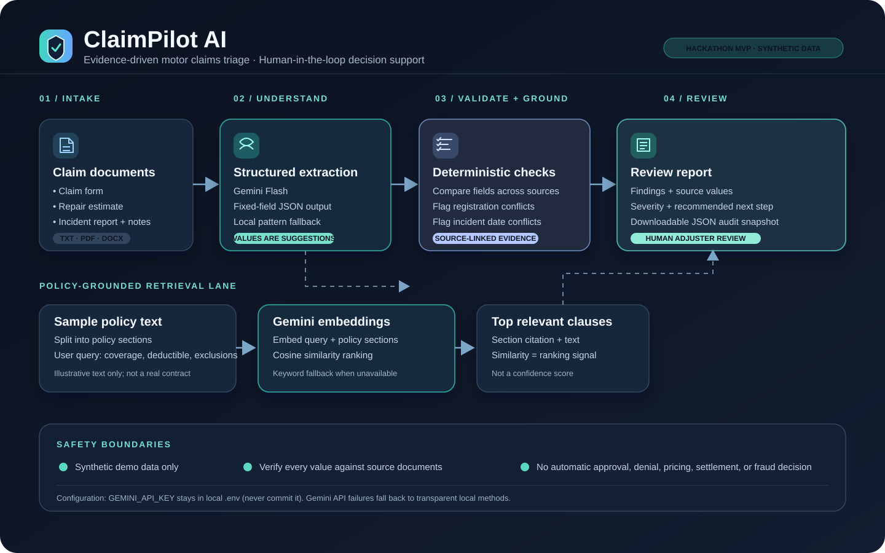
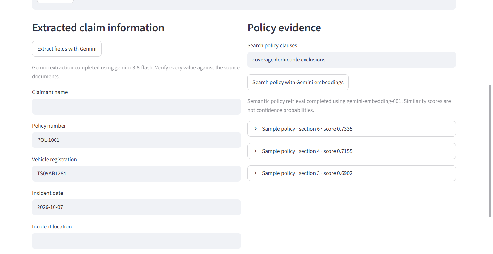
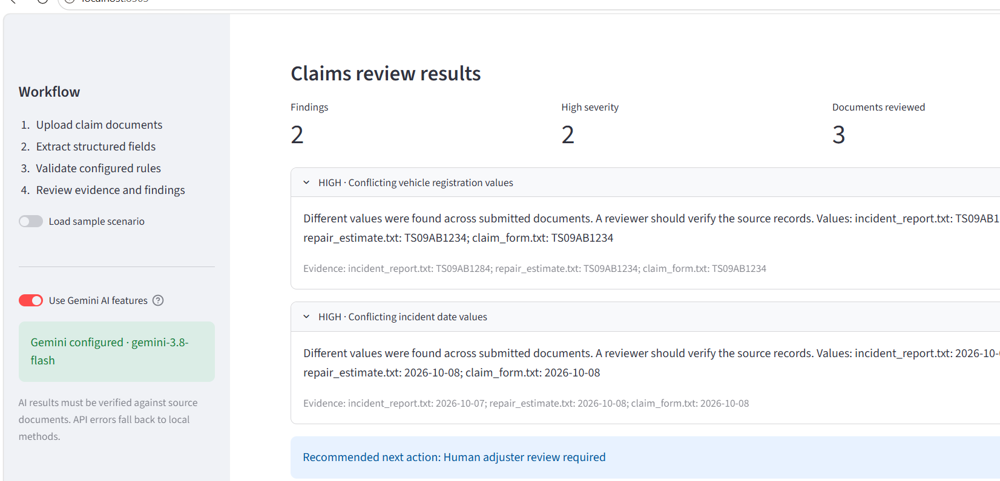

# ClaimPilot AI — Evidence-Driven Insurance Claims Triage

**Flarre AI Hackathon 2026 · Working Streamlit prototype · Synthetic data only**

ClaimPilot AI helps a human motor-claims adjuster review a claim packet faster by extracting key fields, comparing values across documents, retrieving potentially relevant policy wording, and presenting findings with source evidence. It is a decision-support prototype, not an automated claims decision system.

## Architecture



### Workflow

1. **Intake** — use the built-in synthetic scenario or upload `.txt`, `.pdf`, or `.docx` claim documents, plus optional incident notes.
2. **Structured extraction** — use Gemini Flash to suggest a fixed set of claim fields. Local pattern-based extraction is available as a fallback.
3. **Cross-document validation** — deterministic checks compare document values and flag disagreements (including vehicle registration and incident date) with the source file names and values.
4. **Policy retrieval** — Gemini embeddings rank relevant policy sections for a natural-language query. Keyword retrieval is the fallback. Similarity scores are ranking signals, not probabilities.
5. **Human review** — examine findings and policy evidence, then download a JSON review/audit snapshot.

## Screenshots

**Gemini field extraction and semantic policy retrieval**



**Evidence-backed review findings**



See [`docs/DEMO_CHECKLIST.md`](docs/DEMO_CHECKLIST.md) for a short demonstration flow.

## Features

- Streamlit dashboard for sample claims or TXT/PDF/DOCX document uploads
- Gemini structured extraction with fixed, schema-checked fields
- Gemini embedding-based semantic retrieval with policy section citations
- Deterministic cross-document discrepancy checks
- Local extraction and keyword-search fallbacks for API/configuration errors
- JSON review and audit snapshot downloads
- Explicit human-in-the-loop boundary

## Setup — Windows Command Prompt

Run these commands from the folder that contains `requirements.txt`:

```cmd
py -m venv .venv
.venv\Scripts\activate.bat
python -m pip install --upgrade pip
python -m pip install -r requirements.txt
copy .env.example .env
```

Open `.env` in VS Code and add your own Gemini key:

```dotenv
LLM_PROVIDER=gemini
GEMINI_API_KEY=YOUR_GEMINI_API_KEY
LLM_MODEL=gemini-3.8-flash
GEMINI_EMBEDDING_MODEL=gemini-embedding-001
```

Create a key in [Google AI Studio](https://aistudio.google.com/apikey). Do not paste the key into chat, source code, screenshots, issues, or GitHub. The actual `.env` file is ignored by Git; commit `.env.example` only. Restart Streamlit after changing `.env`.

Run the app:

```cmd
python -m streamlit run app\main.py
```

Open the local URL shown in your terminal. For the fastest walkthrough, keep **Load sample scenario** enabled and switch on **Use Gemini AI features**. Click **Extract fields with Gemini**, then click **Search policy with Gemini embeddings**, and finally click **Run claims review**. You may turn off the sample scenario to upload your own synthetic test documents.

## Tests

```cmd
python -m pytest -q
```

Tests should not require a live Gemini API key; live API calls are optional and depend on valid key access, model availability, network connectivity, and quota.

## Safety and limitations

- Use synthetic data only; do not upload real policyholder or claim records.
- Document contents are untrusted evidence, not instructions to the model.
- AI-extracted values are suggestions; check them against the original source documents.
- Conflicts are review signals, not conclusions about coverage or fraud.
- Policy similarity scores are retrieval rankings, not confidence probabilities or coverage determinations.
- API failures fall back to local methods, and the UI reports the method/status.
- The prototype does not approve, deny, price, or settle claims.
- This is a hackathon MVP, not a production carrier integration or legal/compliance certification.

## Repository layout

```text
app/                 Streamlit UI, validation engine, Gemini services
data/sample_claim/   Fictional claim and policy documents
docs/                Architecture diagram, screenshots, demo checklist
tests/               Unit tests
.env.example         Safe environment-variable template
requirements.txt     Python dependencies
```
